<!--
  Profile README for YashMali18/YashMali18
  REPLACE BEFORE PUBLISHING:  YOUR-VERCEL-APP.vercel.app  ->  your own deployed github-readme-stats host
  (appears in 6 image URLs below; use Find and Replace once, then delete this comment)
-->

<picture>
  <source media="(prefers-color-scheme: dark)" srcset="dark.svg">
  <source media="(prefers-color-scheme: light)" srcset="light.svg">
  
</picture>

## Hi, I'm Yash Mali

I'm an AI & Data Science undergraduate student. I'm learning, building and shipping, with a current focus on **C** and **Data Structures**, using **Git** and **GitHub** to keep track of it all.

## Skills

| Core skills | Tools |
| :--- | :--- |
| C, Data Structures | Git, GitHub |

## GitHub stats

  <picture>
    <source media="(prefers-color-scheme: dark)" srcset="https://streak-stats.demolab.com/?user=YashMali18&hide_border=true&background=0A101F&ring=22D3EE&fire=10B981&currStreakNum=E2E8F0&sideNums=E2E8F0&currStreakLabel=A78BFA&sideLabels=94A3B8&dates=94A3B8">
    <source media="(prefers-color-scheme: light)" srcset="https://streak-stats.demolab.com/?user=YashMali18&hide_border=true&background=FFFFFF&ring=0891B2&fire=10B981&currStreakNum=0F172A&sideNums=0F172A&currStreakLabel=7C3AED&sideLabels=475569&dates=475569">
    
  </picture>

  <picture>
    <source media="(prefers-color-scheme: dark)" srcset="https://YOUR-VERCEL-APP.vercel.app/api?username=YashMali18&show_icons=true&hide_rank=true&hide_border=true&bg_color=0A101F&title_color=22D3EE&icon_color=A78BFA&text_color=94A3B8">
    <source media="(prefers-color-scheme: light)" srcset="https://YOUR-VERCEL-APP.vercel.app/api?username=YashMali18&show_icons=true&hide_rank=true&hide_border=true&bg_color=FFFFFF&title_color=0891B2&icon_color=7C3AED&text_color=475569">
    
  </picture>
  <picture>
    <source media="(prefers-color-scheme: dark)" srcset="https://YOUR-VERCEL-APP.vercel.app/api/top-langs/?username=YashMali18&layout=compact&hide_border=true&bg_color=0A101F&title_color=22D3EE&text_color=94A3B8">
    <source media="(prefers-color-scheme: light)" srcset="https://YOUR-VERCEL-APP.vercel.app/api/top-langs/?username=YashMali18&layout=compact&hide_border=true&bg_color=FFFFFF&title_color=0891B2&text_color=475569">
    
  </picture>

## Contribution snake

<picture>
  <source media="(prefers-color-scheme: dark)" srcset="https://raw.githubusercontent.com/YashMali18/YashMali18/output/github-snake-dark.svg">
  <source media="(prefers-color-scheme: light)" srcset="https://raw.githubusercontent.com/YashMali18/YashMali18/output/github-snake.svg">
  
</picture>
